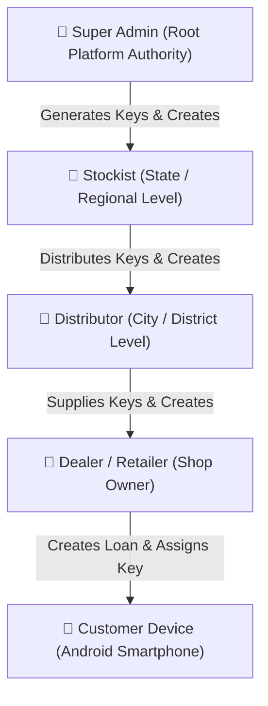
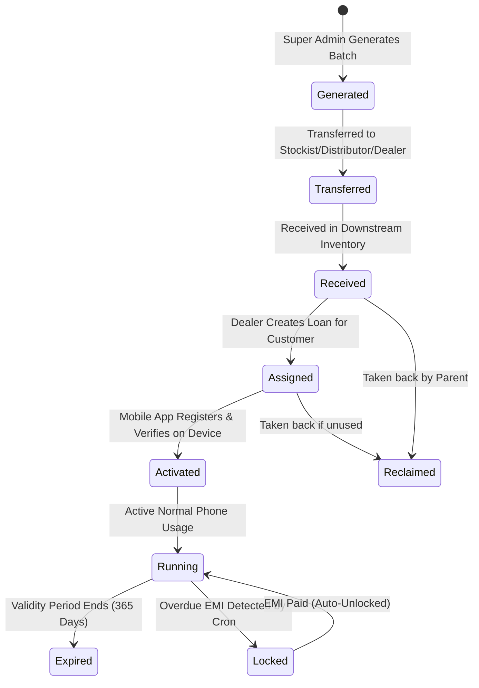
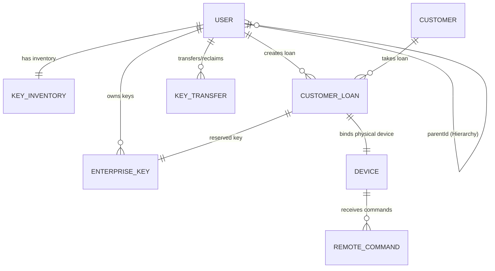

# VLocker Enterprise MDM & Finance Locking System
## Complete Architecture, Working Flow & Keys Management Guide (Hinglish)

---

## 📑 Table of Contents (Index)
1. [Project Ka Motive, Purpose Aur Problem Statement (Why & What)](#1-project-ka-motive-purpose-aur-problem-statement)
2. [5-Tier Hierarchy & Roles Architecture (The Chain)](#2-5-tier-hierarchy--roles-architecture)
3. [Enterprise License Keys Ka Pura Flow](#3-enterprise-license-keys-ka-pura-flow)
   - [3.1 Key Lifecycle & Statuses](#31-key-lifecycle--statuses)
   - [3.2 Key Generation Flow (Super Admin)](#32-key-generation-flow-super-admin)
   - [3.3 Chain of Transfer (Top-to-Bottom Movement)](#33-chain-of-transfer-top-to-bottom-movement)
   - [3.4 Keys Reclaim Flow (Reverse Transfer)](#34-keys-reclaim-flow-reverse-transfer)
   - [3.5 Loan Creation Par Key Assignment (Dealer → Customer)](#35-loan-creation-par-key-assignment-dealer--customer)
   - [3.6 Device Activation Flow (Assigned → Activated)](#36-device-activation-flow-assigned--activated)
4. [End-to-End Application Working Flow (Step-by-Step)](#4-end-to-end-application-working-flow)
5. [Device Provisioning & Mobile MDM Architecture (Android Device Owner)](#5-device-provisioning--mobile-mdm-architecture)
6. [Automated EMI Scheduler, Auto-Lock & Auto-Unlock Engine](#6-automated-emi-scheduler-auto-lock--auto-unlock-engine)
7. [Remote MDM Commands & Policy Restrictions](#7-remote-mdm-commands--policy-restrictions)
8. [Database Models, Schema & Inventory Sync Deep-Dive](#8-database-models-schema--inventory-sync-deep-dive)
9. [Security, Anti-Tampering & Edge Cases](#9-security-anti-tampering--edge-cases)
10. [Major API Endpoints Reference](#10-major-api-endpoints-reference)

---

## 1. Project Ka Motive, Purpose Aur Problem Statement

### 📌 Asli Problem Kya Thi? (Real-World Industry Pain Point)
Retail market mein jab ek mobile shopkeeper ya finance company kisi customer ko **EMI (Kist) par smartphone** bechti hai, toh unhe bohot bada financial loss jhelna padta hai:
1. **EMI Defaulters (Payment Na Dena):** Customer 1 ya 2 kist dene ke baad EMI dena band kar deta hai.
2. **Device Tampering & Theft:** Customer phone ko hard reset (factory reset) kar deta hai, apna SIM card fek deta hai, ya doosre shahar chala jata hai.
3. **Legal & Recovery Overhead:** Ek ₹15,000–₹25,000 ke phone ke liye court jana ya recovery agents bhejna profitable nahi hota. Phone recover karna lagbhag impossible ho jata hai.

### 💡 VLocker Ka Solution Aur Motive
**VLocker ek Enterprise-grade Mobile Device Management (MDM) + FinTech Loan Recovery System hai.**
Yeh Samsung Knox ya Google Enterprise jaisa software solution provide karta hai jo phone ki hardware aur operating system layer ko control karta hai:
- **Zero Default Risk:** Agar customer EMI date par paise nahi deta, toh system phone ko instantly **Remote Lock** kar deta hai.
- **Normal Usage on Payment:** Jaise hi customer UPI, Cash ya Portal se payment karta hai, phone automatically **Unlock** ho jata hai.
- **Anti-Theft & Anti-Bypass:** Phone ko customer format (reset) nahi kar sakta, app uninstall nahi kar sakta, developer options aur USB debugging band rehti hai, aur SIM swap par alert milta hai.
- **B2B Distribution Network:** Ek transparent multi-tier distribution network (Super Admin → Stockist → Distributor → Dealer) provide karta hai jisme license keys ek secure digital currency ki tarah transfer hoti hain.

---

## 2. 5-Tier Hierarchy & Roles Architecture

System mein 5 distinct levels hain jahan data, permissions aur license keys top-to-bottom flow karti hain:



### 1. Super Admin (Platform Owner)
- **Role:** `super_admin` ([UserModel.js](file:///c:/projects/Vlocker-Backend-main/src/models/UserModel.js))
- Pure system ka malik.
- **Akela authority jiske paas nayi Keys generate karne ka right hai.**
- Stockists ko onboard karta hai (`STK-1001`, `STK-1002`).
- Global policies, dashboard KPIs, revenue analytics aur audit logs monitor karta hai.
- **Login As (Impersonation):** Kisi bhi downstream user ke account mein bina password login karke troubleshoot kar sakta hai ([enterprise.middleware.js](file:///c:/projects/Vlocker-Backend-main/src/middleware/enterprise.middleware.js#L33-L90)).

### 2. Stockist (State / Regional Partner)
- **Role:** `stockist` (Entity Code: `STK-xxxx`)
- Super Admin se bulk keys (e.g. 10,000 keys) buy karta hai.
- Apne state ya territory mein **Distributors** create karta hai.
- Apni inventory se Distributors ko keys transfer karta hai.
- Apne under chalne wale sabhi distributors aur dealers ki activation performance monitor karta hai.

### 3. Distributor (City / District Partner)
- **Role:** `distributor` (Entity Code: `DST-xxxx`)
- Stockist ke under kaam karta hai.
- Local market ke **Dealers (Mobile Retailers / Shop Owners)** ko create karta hai.
- Stockist se mili hui keys ko Dealers ko transfer karta hai.

### 4. Dealer (Mobile Shopkeeper / Point-of-Sale)
- **Role:** `dealer` (Entity Code: `DLR-xxxx`)
- Retail counter par baithta hai jo customer ko phone sell karta hai.
- Customer ka KYC karta hai, phone ka EMI Loan create karta hai ([CustomerLoan.model.js](file:///c:/projects/Vlocker-Backend-main/src/models/CustomerLoan.model.js)).
- Loan banate waqt dealer ke wallet se **1 Key deduct hokar loan ke sath assign** ho jati hai.
- Phone par QR code scan karke VLocker client app ko Device Owner install karta hai.
- EMI collection track karta hai aur manual lock/unlock bhi trigger kar sakta hai.

### 5. Customer (End User / Mobile Device)
- Smartphone jise EMI par kharida gaya hai.
- Customer ke mobile par VLocker client app Device Owner privileges ke sath chalta hai.
- Har 30 seconds mein background heartbeat bhejta hai aur server se policies/commands fetch karta hai.

---

## 3. Enterprise License Keys Ka Pura Flow

Is system mein **1 Key = 1 Device/Loan ka License (Typically 365 Days Validity)**. 
Keys platform ki main commercial currency hain.



### 3.1 Key Lifecycle & Statuses
Har key [EnterpriseKey.model.js](file:///c:/projects/Vlocker-Backend-main/src/models/EnterpriseKey.model.js) mein ek document hoti hai:
- `Generated`: Super Admin ne generate kiya, abhi root account mein hai.
- `Transferred`: Ek user se doosre user ko send hui.
- `Received`: Receiver ke wallet mein available balance ban gayi.
- `Assigned`: Dealer ne loan banaya, key customer aur IMEI ke sath reserve ho gayi.
- `Activated`: Phone ne internet se connect hoke key verify aur activate kar li.
- `Running`: Device successfully MDM control ke andar normal chal raha hai.
- `Locked`: EMI overdue hone par device locked state mein hai.
- `Expired`: Key ki 365 days ki validity khatam ho chuki hai.
- `Revoked` / `Returned`: Fraud ya cancellation par wapas li gayi.

---

### 3.2 Key Generation Flow (Super Admin)
- **File:** [keyEnterprise.service.js: generateKeys()](file:///c:/projects/Vlocker-Backend-main/src/services/keyEnterprise.service.js#L67-L138)
- **Endpoint:** `POST /api/enterprise/keys/generate`
- **Payload:** `{ "quantity": 1000, "keyType": "standard" }`

#### Generation Steps:
1. Super Admin authentication aur role verify hota hai (`requireEnterpriseRole("super_admin")`).
2. MongoDB session start hota hai with ACID Transaction.
3. System collision-free random unique keys generate karta hai via `allocateKeyNumbers()`:
   - Format: `VLK-XXXX-XXXX-XXXX`
   - Har key batch ka unique `batchId` generate hota hai (e.g., `BATCH-20261013-XXXX`).
4. `EnterpriseKey.insertMany()` se database mein documents insert hote hain:
   ```json
   {
     "keyNumber": "VLK-9821-3482-1102",
     "batchId": "BATCH-89212",
     "currentOwnerId": "<super_admin_id>",
     "originalOwnerId": "<super_admin_id>",
     "status": "Generated",
     "history": [{ "action": "generated", "performedBy": "<super_admin_id>" }]
   }
   ```
5. Super Admin ki [KeyInventory](file:///c:/projects/Vlocker-Backend-main/src/models/KeyInventory.model.js) recalculate hoti hai aur [UserModel.js](file:///c:/projects/Vlocker-Backend-main/src/models/UserModel.js) ka `keys` count sync hota hai.
6. [AuditLog.model.js](file:///c:/projects/Vlocker-Backend-main/src/models/AuditLog.model.js) mein action capture hota hai.

---

### 3.3 Chain of Transfer (Top-to-Bottom Movement)
- **File:** [keyEnterprise.service.js: transferKeys()](file:///c:/projects/Vlocker-Backend-main/src/services/keyEnterprise.service.js#L171-L274)
- **Endpoint:** `POST /api/enterprise/keys/transfer`
- **Payload:** `{ "toUserId": "<target_user_id>", "quantity": 200, "note": "Monthly stock" }`

#### Transfer Execution Logic:
1. **Hierarchy Authorization Check:**
   - Super Admin kisi ko bhi de sakta hai (`stockist`, `distributor`, `dealer`).
   - Stockist sirf apne downstream Distributors ko de sakta hai.
   - Distributor sirf apne downstream Dealers ko de sakta hai.
   - Yeh check [hierarchyTree.service.js](file:///c:/projects/Vlocker-Backend-main/src/services/hierarchyTree.service.js) ke `getDescendantIds()` se enforce hota hai.
2. **Balance & Status Gate:**
   - System transferable filter lagata hai:
     ```javascript
     {
       currentOwnerId: fromUserId,
       isDeleted: false,
       status: { $in: ["Generated", "Allocated", "Transferred", "Assigned"] }
     }
     ```
   - Agar sender ke paas kam keys hain, request reject ho jati hai (`Insufficient keys. Available: X`).
3. **Atomic Ownership Change:**
   - Required quantity ki keys select ki jati hain.
   - `moveKeyOwnership()` function har key ka `currentOwnerId = toUserId` set karta hai aur status `"Transferred"` karta hai.
   - Har key ke `history` array mein entry append hoti hai:
     ```javascript
     history.push({
       action: "transferred",
       fromUserId,
       toUserId,
       performedBy,
       note,
       at: new Date()
     });
     ```
4. **Transfer Record & Ledger:**
   - [KeyTransfer](file:///c:/projects/Vlocker-Backend-main/src/models/KeyTransfer.model.js) document create hota hai:
     - `fromUserId`, `toUserId`, `quantity`, `keyIds: [...]`, `batchId`, `status: "Completed"`.
5. **Inventory Recalculation:**
   - Sender ke `KeyInventory.transferredKeys` badhte hain, available keys ghat te hain.
   - Receiver ke `KeyInventory.receivedKeys` aur available keys badhte hain.
   - Dono users ke `User.keys` balances database transaction ke andar update hote hain.

---

### 3.4 Keys Reclaim Flow (Reverse Transfer)
- **File:** [keyEnterprise.service.js: reclaimKeys()](file:///c:/projects/Vlocker-Backend-main/src/services/keyEnterprise.service.js#L285-L411)
- **Endpoint:** `POST /api/enterprise/keys/reclaim`
- **Payload:** `{ "fromUserId": "<sub_user_id>", "quantity": 50, "note": "Unused inventory reclaim" }`

#### Rule of Reclaiming:
- **Sirf UN-USED Keys wapas li ja sakti hain:** Wahi keys reclaim ho sakti hain jo abhi tak kisi customer ya loan ko assign nahi hui hain (`status` in `Generated`, `Allocated`, `Transferred`, `Received` aur `assignedToCustomerId == null`).
- Jo key phone mein active ho chuki hai (`Assigned` ya `Activated`), usko koi reclaim nahi kar sakta.
- Reclaim hone par [KeyTransfer](file:///c:/projects/Vlocker-Backend-main/src/models/KeyTransfer.model.js) mein status `"Reversed"` ban jata hai.
- Target user ko notification bheja jata hai: `Keys reclaimed by parent`.

---

### 3.5 Loan Creation Par Key Assignment (Dealer → Customer)
- **File:** [CustomerLoan.controller.js: createCustomerloan()](file:///c:/projects/Vlocker-Backend-main/src/controllers/CustomerLoan.controller.js#L97-L210)
- **File:** [activation.service.js: assignKeyForLoan()](file:///c:/projects/Vlocker-Backend-main/src/services/mobile/activation.service.js#L35-L93)
- **Endpoint:** `POST /api/customerLoan/:customerId`

Jab dealer shop par customer ka loan submit karta hai:
1. Dealer ka key balance check hota hai: `if (keysExist.keys <= 0) return "request keys to create loan"`.
2. IMEI duplicate check hota hai.
3. Loan document create hota hai with EMI schedule.
4. `assignKeyForLoan()` call hota hai:
   - Dealer ke available pool se **1 EnterpriseKey** li jati hai.
   - Key ka status ban jata hai: **`"Assigned"`**.
   - Key par stamp lagta hai:
     - `assignedToCustomerId = customerId`
     - `activatedForLoanId = loan._id`
     - `imei = req.body.imeiNumber1`
     - `dealerId = req.userId`
     - `distributorId = hierarchy.distributorId`
     - `stockistId = hierarchy.stockistId`
     - `expiryDate = Date.now() + 365 days`
5. Dealer ka available key balance 1 se decrement ho jata hai.
6. [ActivationHistory.model.js](file:///c:/projects/Vlocker-Backend-main/src/models/ActivationHistory.model.js) mein `event: "ASSIGNED"` log ho jata hai.

---

### 3.6 Device Activation Flow (Assigned → Activated)
- **File:** [activation.service.js: activateForDevice()](file:///c:/projects/Vlocker-Backend-main/src/services/mobile/activation.service.js#L113-L300)
- **Endpoint:** `POST /api/mobile/activate`

Jab customer ke phone par VLocker app open hoke first time activate hota hai:
1. **Device Integrity Gates:**
   - `if (isRooted || isEmulator)` → Reject with `DEVICE_INTEGRITY_FAILED (403)`.
   - `if (device.isBlacklisted)` → Reject with `DEVICE_BLACKLISTED (403)`.
2. **Key Matching:**
   - Phone ke registered mobile number se Customer dhoonda jata hai.
   - Us customer ke naam par `Assigned` key match ki jati hai.
   - Device ka physical IMEI loan ke IMEI se match kiya jata hai (`IMEI_MISMATCH` check).
3. **Binding & Status Flip:**
   - Key ka status badal kar **`"Activated"`** ho jata hai.
   - Hardware IDs key ke sath permanently bind ho jati hain:
     - `key.imei = imei`
     - `key.androidId = androidId`
     - `key.deviceId = deviceId`
     - `key.fcmToken = fcmToken`
4. **Device Collection Record:**
   - [Device.model.js](file:///c:/projects/Vlocker-Backend-main/src/models/Device.model.js) mein document create/update hota hai with status `"ACTIVATED"`.
5. Device ko policy payload return hota hai (Camera allowed, GPS on, FRP accounts, restricted app list).

---

## 4. End-to-End Application Working Flow

Customer ke dukan par aane se lekar loan complete hone tak ka pura process:

```
[Customer Aaya] ──> [Dealer Enters KYC] ──> [Creates Loan with IMEI]
         │
         ▼
[1 Key Deducted & Assigned] ──> [Dealer Scans QR Code on New Phone]
         │
         ▼
[App Installs as Device Owner] ──> [App Activates with Backend]
         │
         ▼
[Normal Phone Usage with 30s Heartbeat]
         │
 ┌───────┴───────────────────────────────┐
 │                                       │
 ▼ (EMI Paid on Time)                    ▼ (EMI Missed / Overdue)
[Status: PAID]                 [Cron Runs Hourly: Status -> OVERDUE]
 │                                       │
 ▼                                       ▼
[Device Continues Working]     [FCM Push + RemoteCommand: LOCK_DEVICE]
                                         │
                                         ▼
                               [Phone Locks & Restricts All Apps]
                                         │
                                         ▼
                               [Customer Pays EMI via UPI/Dealer]
                                         │
                                         ▼
                               [Backend Auto-Unlocks the Device]
```

---

## 5. Device Provisioning & Mobile MDM Architecture

VLocker Android ke standard **Device Owner (DO)** enrollment protocol par chalta hai:
- **Files:** [provisioning.service.js](file:///c:/projects/Vlocker-Backend-main/src/services/provisioning.service.js) & [provisioning.controller.js](file:///c:/projects/Vlocker-Backend-main/src/controllers/provisioning.controller.js)
- **Endpoint:** `GET /api/provisioning/payload`

### QR Code Provisioning Mechanism:
1. Factory reset phone ko jab start karte hain, Welcome screen par lagataar 6 baar tap karne se built-in Android QR code reader khulta hai.
2. Dealer dashboard par generated QR code ko scan karta hai.
3. QR code mein ek specialized JSON payload hota hai:
   ```json
   {
     "android.app.extra.PROVISIONING_DEVICE_ADMIN_COMPONENT_NAME": "com.vlocker/com.vlocker.MyDeviceAdminReceiver",
     "android.app.extra.PROVISIONING_DEVICE_ADMIN_PACKAGE_DOWNLOAD_LOCATION": "https://api.vlocker.in/api/provisioning/apk/VLocker.apk",
     "android.app.extra.PROVISIONING_DEVICE_ADMIN_SIGNATURE_CHECKSUM": "jEpUPqYe74lMZjbWgNd0H6LCWmAlL6LXqE-izuSXR1k",
     "android.app.extra.PROVISIONING_SKIP_ENCRYPTION": true,
     "android.app.extra.PROVISIONING_LEAVE_ALL_SYSTEM_APPS_ENABLED": true,
     "android.app.extra.PROVISIONING_ORGANIZATION_NAME": "V-Locker",
     "android.app.extra.PROVISIONING_ADMIN_EXTRAS_BUNDLE": {
       "loanId": "65b...",
       "imei1": "8642010...",
       "customerId": "65a..."
     }
   }
   ```
4. **Android OS ka behavior:**
   - Phone WiFi se connect hoke APK silent download karta hai.
   - Certificate signature checksum verify karta hai.
   - Bina kisi user confirmation ke VLocker app ko **Device Owner** bana deta hai.
   - Ek baar Device Owner banne ke baad customer app ko kisi bhi haal mein **uninstall nahi kar sakta**.

---

## 6. Automated EMI Scheduler, Auto-Lock & Auto-Unlock Engine

System mein automated cron jobs hain jo bina kisi human intervention ke overdue loans ko manage karti hain:
- **File:** [scheduler.js](file:///c:/projects/Vlocker-Backend-main/src/cron/scheduler.js)

### 6.1 Hourly Auto-Lock Cron (`0 * * * *`)
Har 1 ghante par scheduler background mein execute hota hai:
1. Sabhi `loanStatus: "APPROVED"` wale loans fetch hote hain.
2. Har loan ki installments check hoti hain:
   - Agar `dueDate < now` aur status `PAID` nahi hai, toh status badal kar **`OVERDUE`** kar diya jata hai.
   - Overdue days calculate hote hain aur late fee add ho jati hai via [overdueUtils.js](file:///c:/projects/Vlocker-Backend-main/src/utils/overdueUtils.js).
3. **Locking Condition:**
   - `const lockThreshold = loan.overdueDaysToLock || 1;`
   - Agar overdue days threshold se jyada hain aur device abhi `UNLOCKED` hai:
     - Scheduler call karta hai [lockDeviceCore()](file:///c:/projects/Vlocker-Backend-main/src/services/DeviceService.js#L29-L77).
     - Firebase Cloud Messaging (FCM) high-priority push send hota hai customer ke phone ko.
     - [RemoteCommand](file:///c:/projects/Vlocker-Backend-main/src/models/RemoteCommand.model.js) create hota hai with type: `LOCK_DEVICE`.
     - Phone screen par full-screen un-dismissible lock window show hoti hai, jisme overdue EMI, dealer ka number aur payment UPI QR code display hota hai.

### 6.2 Auto-Unlock Logic
- Jab customer loan ki EMI pay karta hai (Razorpay UPI gateway ya dealer cash receipt entry se):
  - Installment `PAID` mark hoti hai.
  - Scheduler ya payment controller check karta hai: `totalDuesPending <= 0`.
  - Agar total pending balance 0 ho gaya, toh [unlockDeviceCore()](file:///c:/projects/Vlocker-Backend-main/src/services/DeviceService.js#L84-L120) execute hota hai.
  - FCM push notification phone ko chala jata hai aur phone instant **UNLOCKED** ho jata hai.

### 6.3 Daily Key Expiry Sweep (`5 0 * * *`)
- Roz raat 12:05 baje cron chalta hai jo 365 days se purani keys ko scan karke status **`"Expired"`** mark karta hai aur dealer ko renewal notification bhejta hai.

---

## 7. Remote MDM Commands & Policy Restrictions

Server aur mobile ke beech remote control via [command.service.js](file:///c:/projects/Vlocker-Backend-main/src/services/mobile/command.service.js) chalta hai:

### Supported Remote Commands:
| Command Type | Backend Effect | Mobile Action |
|---|---|---|
| `LOCK_DEVICE` | `loan.deviceUnlockStatus = LOCKED` | Full screen lock overlay, touch frozen except emergency dialer & payment |
| `UNLOCK_DEVICE` | `loan.deviceUnlockStatus = UNLOCKED` | Normal screen restored |
| `FACTORY_RESET` | Phone record deleted/marked wiped | Remote full hardware wipe (agar phone chori ho gaya ho) |
| `REBOOT` | Logged in audit | Phone remotely restart hota hai |
| `DISABLE_CAMERA` | Device policy updated | Hardware camera sensor disable |
| `DISABLE_CALLS` | Dialer block flag set | Outgoing calls restricted |
| `DISABLE_USB` | USB debugging & MTP disabled | PC se phone connect karke bypass rokna |
| `SHOW_MESSAGE` | Flash alert created | Screen par message pop-up ("Kripya kal tak EMI bharein") |
| `SYNC_POLICY` | Version bumped | New restrictions refresh karna |

### Persistent Device Policies:
- **`isResetAllowed: false`** — Settings se factory reset option disable.
- **`isUninstallAllowed: false`** — VLocker app delete karna impossible.
- **`frpAccounts: [...]`** — Dealer/Company ka Google account bind hota hai. Agar koi recovery mode se wipe bhi kar de, toh phone bina us Google account ke on nahi ho sakta.
- **`isDeveloperOptionsBlocked: true`** — USB Debugging / Developer mode disabled.

---

## 8. Database Models, Schema & Inventory Sync Deep-Dive

### Key Models & Relationships:



1. **[UserModel.js](file:///c:/projects/Vlocker-Backend-main/src/models/UserModel.js):**
   - User entity codes: `STK-1001`, `DST-1001`, `DLR-1001`.
   - Fields: `enterpriseRole`, `parentId`, `keys` (cached available count), `territory`, `city`, `gst`.
2. **[EnterpriseKey.model.js](file:///c:/projects/Vlocker-Backend-main/src/models/EnterpriseKey.model.js):**
   - Fields: `keyNumber`, `batchId`, `currentOwnerId`, `status`, `assignedToCustomerId`, `activatedForLoanId`, `imei`, `androidId`, `deviceId`, `expiryDate`, `history: [...]`.
3. **[KeyInventory.model.js](file:///c:/projects/Vlocker-Backend-main/src/models/KeyInventory.model.js):**
   - Real-time ledger: `totalKeys`, `availableKeys`, `transferredKeys`, `receivedKeys`, `activatedKeys`, `expiredKeys`, `lockedKeys`.
4. **[KeyTransfer.model.js](file:///c:/projects/Vlocker-Backend-main/src/models/KeyTransfer.model.js):**
   - Audit trail of transfers: `fromUserId`, `toUserId`, `quantity`, `keyIds`, `batchId`, `status: Completed|Reversed`.
5. **[CustomerLoan.model.js](file:///c:/projects/Vlocker-Backend-main/src/models/CustomerLoan.model.js):**
   - Fields: `mobilePrice`, `downPayment`, `loanAmount`, `emiAmount`, `numberOfEMIs`, `frequency`, `imeiNumber1`, `imeiNumber2`, `deviceUnlockStatus`, `installments: [...]`.
6. **[Device.model.js](file:///c:/projects/Vlocker-Backend-main/src/models/Device.model.js):**
   - Fields: `deviceId`, `fcmToken`, `deviceModel`, `brand`, `androidVersion`, `isRooted`, `isBlacklisted`, `heartbeatAt`, `isLocked`.

---

## 9. Security, Anti-Tampering & Edge Cases

1. **Root & Bootloader Detection:**
   - Phone par Magisk, SuperSU ya unlocked bootloader detected hone par activation reject ho jati hai.
2. **Offline Defaulter Protection:**
   - Agar customer phone ka internet / WiFi / SIM band kar deta hai taaki lock command na pahuche:
   - Mobile app mein **Offline Timer Engine** chalta hai. Agar phone last sync date ke baad `X` ghante tak internet se connect nahi hota aur EMI due date nikal chuki hai, toh app **locally phone ko self-lock** kar deta hai.
3. **SIM Card Change Detection:**
   - App phone ke SIM Slot aur ICCID ko track karta hai. Agar customer SIM change karta hai, toh server ko silent alert chala jata hai aur naye SIM ka number aur carrier log ho jata hai.
4. **Hardware Factory Reset Protection (FRP):**
   - Normal phone ko switch off karke Recovery mode (Volume Up + Power button) se format karne par bhi phone locked rehta hai kyunki enterprise FRP account bind hota hai.
5. **Replay & Command Idempotency:**
   - Sabhi remote commands UUID `commandRef` ke sath aate hain. Duplicate execution ya replayed network packets discard ho jate hain.

---

## 10. Major API Endpoints Reference

### 🔐 Authentication (`/api/auth` & `/api/mobile/auth`)
- `POST /api/auth/login` — Enterprise web portal login (Super Admin, Stockist, Distributor, Dealer).
- `POST /api/mobile/auth/request-otp` — Customer mobile OTP request.
- `POST /api/mobile/auth/login` — Customer phone login with rotating JWT refresh tokens.

### 🔑 Enterprise & Keys Management (`/api/enterprise`)
- `GET /api/enterprise/dashboard` — Role-scoped analytics, KPIs, monthly trends.
- `GET /api/enterprise/keys` — Filtered list of license keys.
- `POST /api/enterprise/keys/generate` — Super Admin key batch creation.
- `POST /api/enterprise/keys/transfer` — Keys transfer down the hierarchy.
- `POST /api/enterprise/keys/reclaim` — Unused keys reclaim from downstream.
- `POST /api/enterprise/stockists` — Super Admin creates Stockist.
- `POST /api/enterprise/distributors` — Stockist creates Distributor.
- `POST /api/enterprise/dealers` — Distributor creates Dealer.
- `POST /api/enterprise/login-as` — User impersonation token.

### 📱 Mobile & MDM (`/api/mobile` & `/api/mdm`)
- `POST /api/mobile/activate` — Device hardware registration & key activation.
- `POST /api/mobile/heartbeat` — Periodic 30s telemetry (battery, network, GPS, lock status).
- `GET /api/mobile/device/:deviceId/commands` — Device polls pending remote commands.
- `POST /api/mobile/commands/ack` — Device reports command execution result.
- `POST /api/mdm/commands` — Dealer/Admin sends remote MDM command (Lock/Unlock/Wipe).
- `GET /api/provisioning/payload` — Device Owner enrollment QR code JSON generator.

---
*Documented for VLocker Backend System.*
